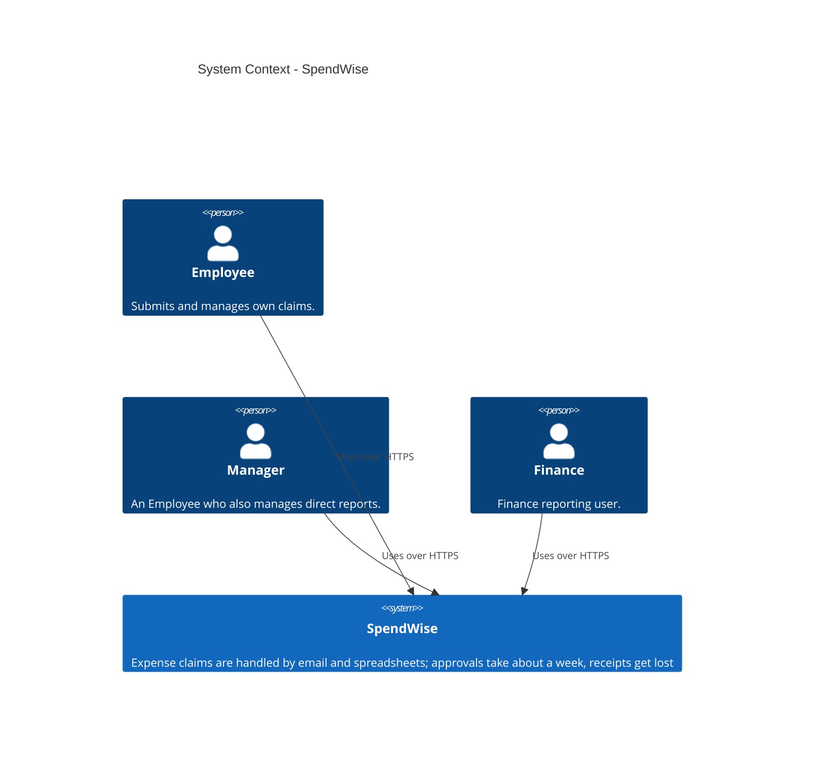
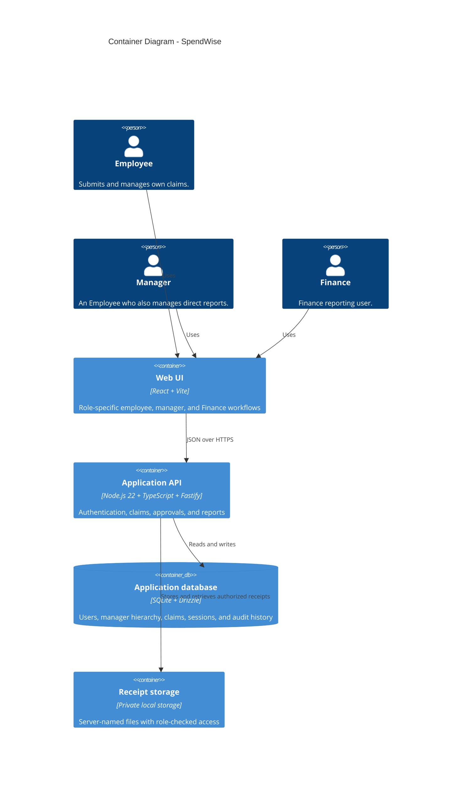
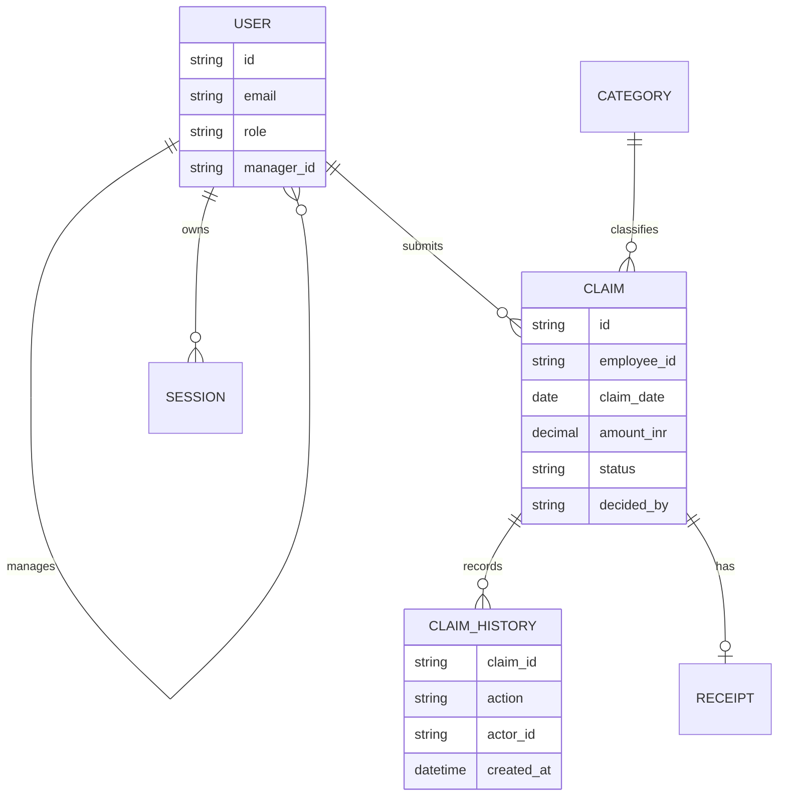

# SpendWise Architecture

Version 1.0 · Design checkpoint · Generated by ForgeFlow Architect-Dev

## Context



## Containers



## Technology decisions (ADRs)

| Decision | Choice | Justification |
| --- | --- | --- |
| Runtime | Node.js 22 + TypeScript | Matches the approved repository stack and CI image |
| HTTP | Fastify | The requirements allow Fastify or Express; Fastify provides typed request validation and route schemas |
| UI | React + Vite | Matches the stated frontend preference |
| Persistence | SQLite via Drizzle | Both are explicit allowed preferences; SQLite is accepted for the demo |
| Tests | Vitest, Playwright, and k6 | Matches the stated unit, functional, and load-test preferences |
| Approved stack constraints | TypeScript everywhere. Node.js 22, REST API with Fastify (Express is fine), React + Vite<br>front end served by the same container, SQLite via Drizzle or Prisma, Vitest for unit tests,<br>Playwright for functional tests, k6 for load tests. One Docker container for the app. | Keeps the selected stack within the captured preferences |

## Module structure

```
src/auth/             password hashing, inactivity sessions, and login lockout
src/claims/           claim validation, duplicate detection, status changes, and history
src/approvals/        direct-manager queue, self-approval guard, and auto-approval
src/receipts/         upload validation and role-checked receipt access
src/reports/          monthly aggregates and spreadsheet-safe CSV export
src/db/               SQLite schema, migrations, and idempotent seed loader
src/http/             authenticated REST routes and health endpoint
web/                  responsive React + Vite application
test/                 business-rule and API tests
e2e/                  seeded-user Playwright acceptance tests
DOCs/openapi.yaml     OpenAPI surface derived from the supplied API contract
```

## Data model



## API contract and authentication

The OpenAPI path list is generated from the supplied contract. The complete contract is preserved below for review:

```text
POST   /api/auth/login            {email,password} -> 200 user + HttpOnly session cookie
                                   401 INVALID_CREDENTIALS, 423 ACCOUNT_LOCKED
POST   /api/auth/logout           -> 204
GET    /api/me                    -> current user
GET    /api/claims?status=&month=YYYY-MM&category=&page=
                                   -> {items,total,page,pageSize,sumAmount}
POST   /api/claims                JSON, or multipart/form-data when a receipt is attached:
                                   date, category, amount, description, receipt?, confirmDuplicate?
                                   -> 201 claim | 422 VALIDATION_FAILED | 409 DUPLICATE_CLAIM
GET    /api/claims/{id}           -> claim + history (403/404 if not allowed)
PATCH  /api/claims/{id}           -> 200 | 409 CLAIM_LOCKED
DELETE /api/claims/{id}           -> 204 | 409 CLAIM_LOCKED
GET    /api/claims/{id}/receipt   -> file (owner, their manager, finance only)
GET    /api/team/claims?status=Submitted -> manager queue
POST   /api/claims/{id}/approve   -> 200 | 403 FORBIDDEN | 403 SELF_APPROVAL_NOT_ALLOWED | 409 CLAIM_LOCKED
POST   /api/claims/{id}/reject    {comment} -> 200 | 422 COMMENT_REQUIRED
GET    /api/reports/monthly?month=YYYY-MM -> {month, byCategory[], byEmployee[], statusCounts,
                                   grandTotal, approvedCount}
GET    /api/reports/monthly.csv?month=YYYY-MM -> text/csv
GET    /api/health

Error body: {"error":{"code":"...","message":"...","fields":[{"field":"amount","code":"AMOUNT_OUT_OF_RANGE","message":"..."}]}}
Field codes: AMOUNT_INVALID, AMOUNT_OUT_OF_RANGE, AMOUNT_PRECISION, DATE_INVALID,
DATE_IN_FUTURE, DATE_BEFORE_POLICY_START, INVALID_CATEGORY, DESCRIPTION_LENGTH,
MEALS_LIMIT_EXCEEDED, RECEIPT_REQUIRED, FILE_TOO_LARGE, FILE_TYPE_NOT_ALLOWED.
Other codes: UNAUTHENTICATED (401), FORBIDDEN (403), NOT_FOUND (404).
Money in JSON is a string with 2 decimals, e.g. "1234.50".
```

Password hashes use the configured Argon2id or bcrypt cost; session cookies are HttpOnly and SameSite=Lax, Secure over
HTTPS, and expire after 30 minutes of inactivity. Every protected operation performs a server-side role and ownership
check. Managers may act only on direct reports and never on their own claims.

## Security and privacy

OWASP Top 10; Argon2id or bcrypt cost >=12; server-side role checks; HttpOnly/SameSite=Lax/Secure-over-HTTPS session cookies; same-origin checks for state changes; CSP, nosniff, frame-ancestors none, no X-Powered-By; max 10 failed logins/IP/minute; 5 MB body limit; no stack traces; server-generated receipt names.

0 passwords, tokens, or receipt contents logged; receipts are visible only to the 3 authorized roles (owner, direct manager, Finance).

## NFR tactics

| Requirement | Target | Tactic |
| --- | --- | --- |
| NFR-01 | Performance (latency, throughput, concurrent users) | p95 under 500 ms for claim list, claim submission, and monthly report with 50 concurrent users; error rate under 1%. | Requirement-specific unit, functional, load, security, or manual test |
| NFR-02 | Scalability | Support the stated 50–200 employee company and 50 concurrent users; larger scale is not specified. | Requirement-specific unit, functional, load, security, or manual test |
| NFR-03 | Availability | 99.5% per month in production, best effort on demo hosting; staging availability is N/A. | Requirement-specific unit, functional, load, security, or manual test |
| NFR-04 | Security (authN/authZ, OWASP Top 10, data protection) | OWASP Top 10; Argon2id or bcrypt cost >=12; server-side role checks; HttpOnly/SameSite=Lax/Secure-over-HTTPS session cookies; same-origin checks for state changes; CSP, nosniff, frame-ancestors none, no X-Powered-By; max 10 failed logins/IP/minute; 5 MB body limit; no stack traces; server-generated receipt names. | Requirement-specific unit, functional, load, security, or manual test |
| NFR-05 | Privacy and compliance | 0 passwords, tokens, or receipt contents logged; receipts are visible only to the 3 authorized roles (owner, direct manager, Finance). | Requirement-specific unit, functional, load, security, or manual test |
| NFR-06 | Accessibility (WCAG level) | WCAG 2.1 AA for login, claim submission, My Claims, manager queue, and reports; fully keyboard operable. | Requirement-specific unit, functional, load, security, or manual test |
| NFR-07 | Usability and responsive breakpoints | Usable at 375 px, 768 px, and 1280 px widths; claim submission under 2 minutes. | Requirement-specific unit, functional, load, security, or manual test |
| NFR-08 | Localisation, currency and time zone | English UI; INR with Indian digit grouping; dates DD-MMM-YYYY in UI and ISO 8601 in API; Asia/Kolkata time zone; Unicode text including Hindi, emoji, and accents. | Requirement-specific unit, functional, load, security, or manual test |
| NFR-09 | Observability | 100% of request logs include a request ID; exactly 1 structured JSON log is emitted per error; /api/health returns status ok. | Requirement-specific unit, functional, load, security, or manual test |
| NFR-10 | Data retention and backup | For demo/UAT, 0 data is retained after redeploy; reset on redeploy is accepted. Production backup/retention duration is not specified and must be confirmed before production. | Requirement-specific unit, functional, load, security, or manual test |
| NFR-11 | Browser support | Support the latest major versions of all 4 specified browsers: Chrome, Edge, Firefox, and Safari. | Requirement-specific unit, functional, load, security, or manual test |

## Test strategy

| Requirement | Acceptance criteria |
| --- | --- |
| FR-01 | Authentication and sessions | AC-01.1 |
| FR-02 | Submit expense claims | AC-02.1 |
| FR-03 | Auto-approve small claims | AC-03.1 |
| FR-04 | Warn about duplicate claims | AC-04.1 |
| FR-05 | List and filter my claims | AC-05.1 |
| FR-06 | Edit or delete submitted claims | AC-06.1 |
| FR-07 | Manager approval queue | AC-07.1 |
| FR-08 | Claim history | AC-08.1 |
| FR-09 | Finance monthly reports | AC-09.1 |
| FR-10 | Export approved claims to CSV | AC-10.1 |
| FR-11 | Idempotent demo data seeding | AC-11.1 |
| FR-12 | Health endpoint | AC-12.1 |

Vitest covers each business rule and role boundary. Playwright covers the supplied UAT cases with seeded users.
k6 runs the reference load test at 50 concurrent users. GitHub Actions runs unit, functional, load, then security stages
in series and ingests their machine-readable reports.

## Deployment topology

For this verification, `Use local Docker for this end-to-end verification. Cloud Run in asia-south1 is the original target after local validation.`. The intended cloud target is
`asia-south1 for a future Cloud Run deployment; not used by this local Docker run.` when a cloud deployment is explicitly configured. The single-container image
runs as a non-root user; staging and production remain separate environments with human approvals.

## Data retention and open questions

For demo/UAT, 0 data is retained after redeploy; reset on redeploy is accepted. Production backup/retention duration is not specified and must be confirmed before production.

- Confirm production data retention and backup requirements beyond the UAT/demo reset behavior before production use.
